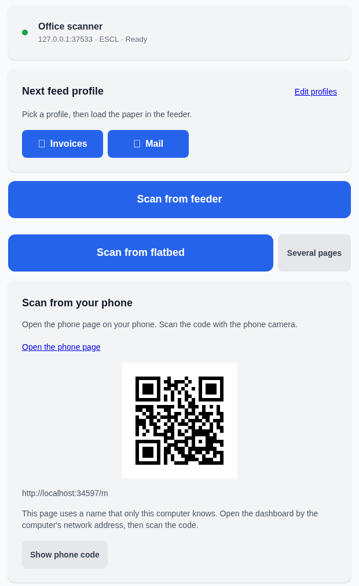
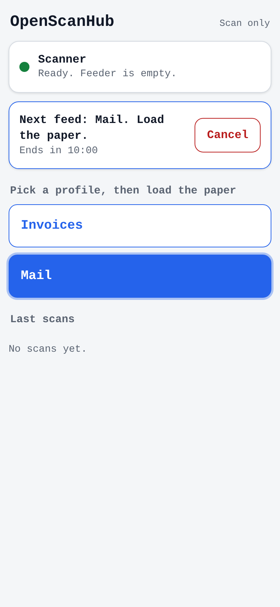

# OpenScanHub

Tags: openscan-hub, readme, scanning
Wiki: [[README]]

**OpenScanHub turns an ordinary home or small-office network scanner into a
business-class one.** Put paper in the feeder. It scans on its own, cleans the
pages, reads them, names the file, and saves it. The file goes to a network
share (SMB), a folder, WebDAV or Nextcloud, email, or Paperless-NGX.

OpenScanHub is built around auto-feed scanning. You do not edit pages by hand.

[](https://github.com/parallaxintelligencepartnership/openscan-hub/releases)
[](LICENSE)




## How it works

1. You pick a profile (optional). A profile is one set of scan, clean-up,
   name and destination settings.
2. You put paper in the document feeder.
3. The feeder monitor sees the paper and starts the scan.
4. OpenScanHub cleans the pages and reads the text.
5. It names the file, for example `2026-03-04 ACME Invoice.pdf`.
6. It saves the file to your destinations. A failed delivery is retried.

No drivers and no vendor apps are needed. OpenScanHub never checks for updates
and never sends usage data.

## Features

- **Feeder monitor.** Scans start when you load paper. Works with eSCL
  (AirScan) scanners.
- **Clean-up.** Deskew, auto-rotate, crop, blank page removal, gray or
  black-and-white, compression, and PDF/A.
- **Text recognition.** OCR makes a searchable PDF.
- **Separator pages.** Split one batch into several files with blank sheets
  or with printed `OSH:` QR sheets.
- **Profiles.** One profile per kind of paper: invoices, letters, receipts.
- **Smart names.** `{doc_date}`, `{title}`, `{vendor}`, `{barcode}`,
  `{pages}`, plus `{date}`, `{time}` and `{n}`.
- **Destinations.** Folder, SMB share, WebDAV or Nextcloud, email, and
  Paperless-NGX (Homelab only).
- **Phone page.** Open `/m` on a phone. It shows the scanner, the feeder and
  the last scans. You pick the profile for the next feed.
- **Other inputs.** FTP receiver, folder watch, SMB share poll, and an email
  mailbox, for scanners that push files.
- **Safe access.** An access token, a session cookie, and Host and Origin
  checks.



## Editions

One codebase, two editions. The build fixes the edition.

| | OpenScanHub (Homelab) | OpenScanHub Office |
|---|---|---|
| For | Home and homelab users | Offices and small businesses |
| Docker tags | `:0.4.0`, `:latest` | `:0.4.0-office`, `:office` |
| Windows file | `OpenScanHub.exe` | `OpenScanHub-Office.exe` |
| Home Assistant module and add-on | Included, off by default | Not shipped |
| Paperless-NGX destination | Included, off by default | Not shipped |
| Scan audit log | Optional, off by default | On by default |
| Access tokens | One token | Admin token and scan token |
| Outside calls | None | None |

Image name: `ghcr.io/parallaxintelligencepartnership/openscan-hub`.
See [docs/editions.md](docs/editions.md).

## Protocol support

| Protocol | Direction | Status |
|---|---|---|
| eSCL (AirScan, Mopria) | OpenScanHub pulls the scan | Supported, with feeder monitor |
| WSD Scan | OpenScanHub pulls the scan | Supported, no feeder monitor |
| FTP receiver | Scanner pushes the file | Supported |
| Folder watch | A tool writes a file | Supported |
| SMB share poll | Scanner writes to a NAS share | Supported |
| Email in (IMAP) | Scanner sends a mail | Supported |

WSD scanners do not report paper in the feeder. Use the Scan button for them.
See [docs/protocols.md](docs/protocols.md) for the research and the plan.

## Quick start

### Docker

```bash
mkdir openscan-hub && cd openscan-hub
curl -O https://raw.githubusercontent.com/parallaxintelligencepartnership/openscan-hub/main/docker-compose.yml
mkdir -p scans
docker compose up -d
```

Open `http://<your-server>:8020`. The image has Tesseract for OCR. See
[docs/install-docker.md](docs/install-docker.md).

### Windows

1. Download `OpenScanHub.exe` and `SHA256SUMS.txt` from the
   [latest release](https://github.com/parallaxintelligencepartnership/openscan-hub/releases/latest).
2. Double-click `OpenScanHub.exe`. Your browser opens the setup page.
3. For OCR, install Tesseract for Windows yourself.

See [docs/install-windows.md](docs/install-windows.md).

### Python

```bash
pip install "openscan-hub @ git+https://github.com/parallaxintelligencepartnership/openscan-hub@v0.4.0"
openscan
```

Open `http://localhost:8020`. Python 3.10 or newer is needed. For exact
dependency versions, use `requirements.lock` with `pip install --require-hashes`.

## Guides

| Guide | Use it to |
|---|---|
| [Feeder to share](docs/setup-feeder-to-share.md) | Set up the main path in about 10 minutes |
| [Install with Docker](docs/install-docker.md) | Run the image on a server or NAS |
| [Install on Windows](docs/install-windows.md) | Run the EXE |
| [Office edition](docs/install-office.md) | Set up scan tokens and the audit log |
| [Scan inputs](docs/inputs.md) | Take files from a share or a mailbox |
| [Destinations](docs/destinations.md) | Set up SMB, WebDAV, email |
| [Home Assistant](docs/home-assistant.md) | Optional buttons and sensor |
| [Architecture](docs/architecture.md) | Change or extend the code |
| [Glossary](docs/glossary.md) | Look up a term |

## License

MIT. See [LICENSE](LICENSE) and [THIRD_PARTY_NOTICES.md](THIRD_PARTY_NOTICES.md).
Built by [Parallax Intelligence Partnership, LLC](https://parallaxintelligence.ai).
