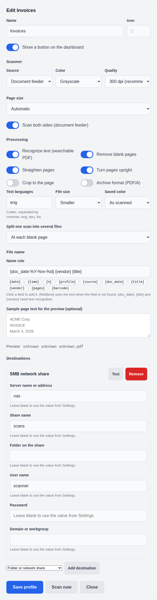

# Set up feeder to share

Tags: docs, setup, guide
Wiki: [[README]]

| Item | Value |
|---|---|
| Version | 0.4.0 |
| Date | 2026-11-06 |
| Standards | ASD-STE100 wording, ISO/IEC/IEEE 26514 layout |

## Purpose

This guide sets up the main OpenScanHub path. Paper goes in the feeder. A
searchable PDF with a smart name goes to a network share.

## Audience

Home and office users. You need no programming skill.

## Before you start

- OpenScanHub runs. See [install with Docker](install-docker.md) or [install on Windows](install-windows.md).
- The scanner is on, on the same network, and supports eSCL (AirScan).
- You have a share name, a user name and a password for the share.
- For OCR on Windows, you installed Tesseract. The Docker image has it.

## Steps

1. Open OpenScanHub in your browser. Finish the setup wizard if it shows.
2. Open **Settings**. Go to the **Scanner** card.
3. Press **Find scanners again**. Pick your scanner from the list.
4. If the list is empty, open **Enter the scanner's IP address**. Type an address such as `192.168.1.50`. Press **Check**.
5. Turn on **Scan automatically when I put paper in the feeder**.
6. Press **Save**.
7. Open **Scan profiles**. Press **New profile**.
8. Enter the name `Invoices`.
9. Set **Source** to **Document feeder**. Turn on **Scan both sides** if you need it.
10. Under **Processing**, turn on **Recognize text (searchable PDF)**.
11. Turn on **Remove blank pages**, **Straighten pages** and **Turn pages upright**.
12. Set **Text languages**. Use codes such as `eng` or `eng,deu`.
13. In **Name rule**, enter `{doc_date:%Y-%m-%d} {vendor} {title}`.
14. Look at **Preview**. Paste sample page text in the box to test the rule.
15. Under **Destinations**, choose **SMB network share**. Press **Add destination**.
16. Enter the server (`nas`), the share (`scans`), the user name and the password.
17. Press **Test** on the destination. Wait for the green message.
18. Press **Save profile**.

> Caution: The **Test** button writes one small file and deletes it. Use a
> share where the account may write and delete.

19. Open the dashboard. Press the **Invoices** button. It becomes the next feed.
20. Load the paper in the feeder. The scan starts on its own.

If you pick no profile, OpenScanHub uses the default profile.

## Smart names

| Field | Value |
|---|---|
| `{doc_date}` | First date in the text. Add a format, for example `{doc_date:%Y-%m}`. |
| `{title}` | First line that looks like a heading. |
| `{vendor}` | A name from your vendor list, or the most prominent line on page 1. |
| `{barcode}` | Text of a barcode or QR code on a separator page. |
| `{pages}` | Page count. |
| `{date}`, `{time}`, `{n}` | Scan date, scan time and a counter. |

The fields `{doc_date}`, `{title}` and `{vendor}` need text recognition.
A missing field becomes `unknown`. Add a vendor list on the profiles page
under **Vendor names**.

## Split one batch into several files

> Caution: With **Scan both sides** on, the empty back of a one-sided sheet
> is a blank page. **At each blank page** then makes one file for each
> sheet. For one-sided paper, turn off **Scan both sides** or use barcode
> separator sheets.

1. Open the profile. Set **Split one scan into several files**.
2. Choose **At each blank page** to split on blank sheets.
3. Or choose **At each barcode page** to split on `OSH:` QR separator sheets.
4. Print a sheet from `/api/separator-sheet?label=Invoice`. Change the label as needed.
5. Put the sheet between the documents in the feeder.

OpenScanHub drops each separator page. The barcode text becomes `{barcode}`.

## Verification

1. Put two pages in the feeder.
2. Wait for the scan to end.
3. Open the share. Find a PDF with the smart name.
4. Open the PDF. Select text. If the text selects, OCR worked.
5. Look at **Recent scans** on the dashboard. The result must say saved.

## Troubleshooting

| Symptom | Cause | Action |
|---|---|---|
| The feeder scan does not start | Monitor is off, or the scanner uses WSD | Turn on the monitor. For WSD, press **Scan from feeder**. |
| The name has `unknown` | OCR is off, or no date or title in the text | Turn on OCR. Check the language code. |
| Warning: text recognition skipped | Tesseract is missing | Install Tesseract on Windows. Use the Docker image. |
| SMB test fails: "Could not reach" | Wrong name or port | Check the server name and that port 445 is open. |
| SMB test fails: rejected | Wrong user, password or domain | Check them from another computer. |
| A failed save shows under "Scans waiting to retry" | The share was offline | Fix the share. OpenScanHub retries. |
| The next feed choice is gone | It ends after one batch or 10 minutes | Pick the profile again. |

## Revision history

| Version | Date | Change |
|---|---|---|
| 0.4.0 | 2026-11-06 | Add the caution about both sides and blank page splits. |
| 0.4.0 | 2026-11-06 | First version. |
